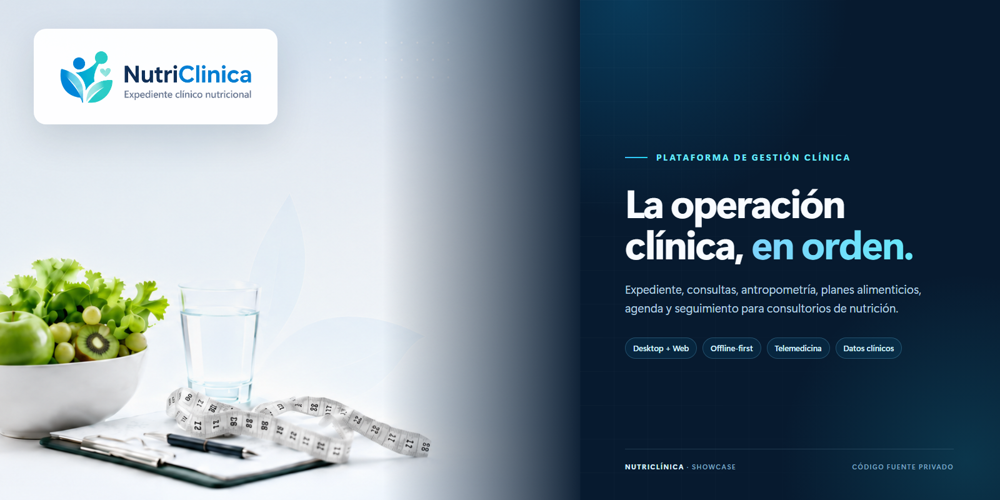
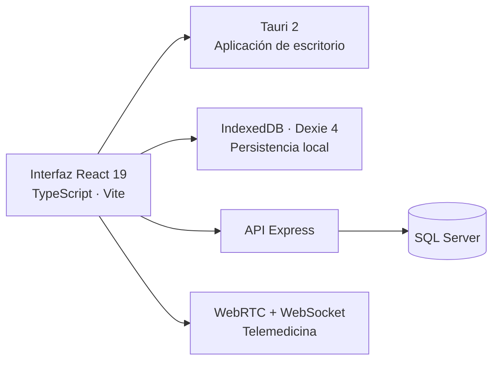

  
  <h1>NutriClínica — Plataforma de Gestión Clínica</h1>
  
<strong>Expediente, consultas y operación clínica en una sola plataforma.</strong>

  

    <a href="https://github.com/JosueLuceroG"><strong>Volver al perfil de GitHub ↗</strong></a>
  

---

> [!IMPORTANT]
> Este repositorio contiene únicamente material de presentación. El código fuente, la configuración y los datos del producto son privados. No se enlaza una demostración pública desde esta presentación.

## El proyecto

NutriClínica es una plataforma profesional para la gestión integral de consultorios de nutrición clínica. Su alcance documentado reúne pacientes, consultas, mediciones antropométricas, laboratorios, planes alimenticios, agenda, cobros, reportes, documentos, telemedicina y portal del paciente.

El producto está diseñado para nutriólogos, clínicas y equipos de salud que necesitan una herramienta organizada para operar la consulta diaria, dar seguimiento clínico y mantener la información disponible en escenarios offline-first.

## Alcance funcional documentado

| Módulo | Capacidades |
| --- | --- |
| Pacientes | Expediente, historial clínico y seguimiento nutricional. |
| Consultas | Registro de consultas, antropometría y composición corporal. |
| Laboratorios | Paneles clínicos, documentos e indicadores de evolución. |
| Planes alimenticios | Creación y administración de planes para cada paciente. |
| Agenda | Citas, alertas, notificaciones y pendientes operativos. |
| Administración | Cobros, pagos, recibos, gastos y reportes. |
| Paciente | Portal personal, telemedicina y soporte para videollamadas. |
| Asistencia clínica | Módulos de IA para apoyo y automatización controlada. |

## Arquitectura

La aplicación combina una interfaz web con una aplicación de escritorio mediante Tauri, persistencia local para trabajo offline-first y una API respaldada por SQL Server.

## Stack técnico verificado

| Capa | Tecnología |
| --- | --- |
| Frontend | React 19, TypeScript 5 y Vite 6 |
| Aplicación de escritorio | Tauri 2 con Rust |
| Persistencia local | IndexedDB mediante Dexie 4 |
| Backend | Express y SQL Server |
| Autenticación | JWT, Argon2 y segundo factor TOTP |
| Telemedicina | WebRTC, señalización WebSocket y cifrado AES-GCM |
| Pruebas | Vitest 3, Playwright y Testing Library |
| Integración continua | GitHub Actions |

## Seguridad y operación

El diseño documentado del proyecto contempla autenticación con JWT, contraseñas protegidas con Argon2, segundo factor TOTP, CORS restringido, límites de solicitudes y manejo de secretos del lado servidor.

La información clínica, la configuración del entorno y el código fuente no forman parte de este repositorio de presentación.

## Estado

- **Producto:** privado y en desarrollo.
- **Demostración pública:** no incluida en esta presentación.
- **Código fuente:** privado.
- **Portada:** composición elaborada con recursos de marca del producto; no contiene datos de pacientes.

## Enlaces

- [Perfil de Josué Lucero](https://github.com/JosueLuceroG)

---

  Material de presentación de NutriClínica. Código fuente privado. Todos los derechos reservados.

